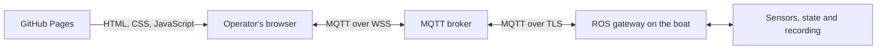

# Agir Boat Monitoring — Boat web app

**Agir Sailing Team · Project documentation**  
_Last updated: 30/10/2026_

## Introduction

This repository contains the web app used to monitor boat data, follow navigation
on the map, and send recording and buoy positioning commands.

The application uses HTML, CSS and native JavaScript modules. **It requires no
React, Angular, application backend or build step:** GitHub Pages serves the files;
the browser exchanges data with the boat through the MQTT broker.

This file provides an overview. Technical details are in the folder-specific READMEs.

## Repository structure

| Path | Contents | Further reading |
|---|---|---|
| [`.github/`](.github/) | Automatic deployment to GitHub Pages. | [Site deployment](.github/README.md) |
| [`assets/`](assets/) | Styles and team logos. | [Visual assets](assets/README.md) |
| [`pages/`](pages/) | HTML fragments for Dashboard and Map. | [HTML views](pages/README.md) |
| [`src/`](src/) | Application coordination, state, communication and rendering. | [JavaScript code](src/README.md) |
| [`test/`](test/) | Automated checks without a broker or boat. | [Tests and manual checks](test/README.md) |
| [`index.html`](index.html) | Login, navbar, view container and initial loading. | [Pages and interface](pages/README.md) |
| [`package.json`](package.json) | ES modules and test command. | [Running tests](test/README.md#running-tests) |

## How the system communicates

GitHub Pages provides the interface but does not collect telemetry. Live data
requires access to the broker and the onboard components publishing it.

## Features

| Feature | Current behaviour |
|---|---|
| Dashboard | Speed, attitude, estimated height, ultrasonic distances, position and battery. |
| Recording | Start/Stop with confirmation from the onboard system and rosbag status. |
| Map | Absolute position, arrow oriented by GPS movement and boat following. |
| Track | Session path; Reset track clears it and starts again from the current position. |
| Buoys | Committee, Pin and Windward display; Ping enabled for the staff account. |
| Demo | Simulated data, without real recording or Ping commands. |
| Draw / Clear line | Draws the start line between Committee and Pin, then allows clearing only the line while keeping buoys and track. Both buoys are required to draw it. |

Command conditions are described in the [pages guide](pages/README.md).
Actual permissions must also be configured on the broker: the browser's staff
check currently applies to **Ping**, not to every command.

## Getting started

1. Open the HTTPS address of the [published site](https://agirsailing.github.io/agir_boat_monitoring/).
2. To explore the interface, choose **Explore demo** on the login screen.
3. For live data, enter the MQTT credentials assigned by the team and press **Connect to boat**.
4. Wait for telemetry: **Broker connected** confirms the connection.
5. Use the navbar to switch views while keeping the same MQTT session.

The map and external libraries require Internet access. A dash `—` indicates
a missing measurement.
