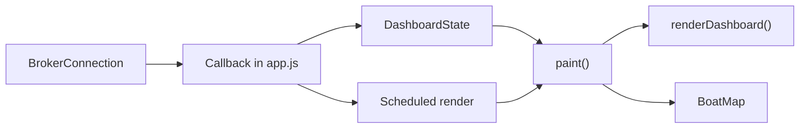

# JavaScript code — Application coordination

**Agir Boat Monitoring · `src/`**  
_Last updated: 30/10/2026_

[Project overview](../README.md) · [Tests](../test/README.md)

## Introduction

`src/` contains the code executed in the browser. Responsibilities are separated:
`core/` interprets state, `services/` handles MQTT and `ui/` updates the interface.
[`app.js`](app.js) connects these components to page events.

There is no build step: [`index.html`](../index.html) loads `./src/app.js` as an
ES module. Imports of other modules are relative to the file declaring them.

## Structure

| Path | Responsibility | Documentation |
|---|---|---|
| [`app.js`](app.js) | Initialization, events, demo, commands and render coordination. | This page |
| [`config.js`](config.js) | Public topics, staff list and time limits. | Configuration, below |
| [`core/`](core/) | Samples, validation, permissions, pending requests and diagnostics. | [Shared logic](core/README.md) |
| [`services/`](services/) | MQTT session, subscriptions, publishing and reconnection. | [Communication](services/README.md) |
| [`ui/`](ui/) | Navigation, dashboard readings and map objects. | [Rendering](ui/README.md) |

## Startup and data flow

1. `startApp()` loads all HTML fragments through `mountPages()`.
2. It creates `DashboardState`, `LiveDiagnostics`, `BoatMap` and the render scheduler.
3. It connects login, recording, Ping, Draw / Clear line, Reset track, demo and navigation.
4. On login, it creates the MQTT connection; accepted subscriptions enable the `ready` state.
5. Each message immediately updates state or resolves a pending request.
6. `render()` schedules `paint()`, which reads the latest state and updates the interface.

If initial loading fails, the login screen displays a message and disables Connect
and Demo. If a visual update fails, `renderErrors` is incremented and subsequent
renders can resume.

## Updating the interface

`createRenderScheduler()` keeps at most one pending `requestAnimationFrame`.
Multiple messages arriving before a render are therefore displayed using the latest
available state. This reduces visual updates; **it does not drain network queues**.

| Activity | When it happens |
|---|---|
| Handling telemetry and responses | On MQTT reception. |
| Rendering | At the next available frame, without accumulating render requests. |
| Expiry checks and diagnostics | A timer every 250 ms. |
| Map updates | A new map sample, its expiry or a visibility change. |
| View changes | The `hashchange` event; elements remain mounted. |

The browser may slow down frames and timers when the tab is in the background.
The track represents the session, not a complete recording of every received message.

## Public configuration

Values are defined in [`config.js`](config.js). The time values below are in milliseconds.

| Constant | Value | Meaning |
|---|---:|---|
| `dataTimeoutMs` | 3000 | Dashboard and map sample expiry in the browser. |
| `recordingTimeoutMs` | 5000 | Recording state expiry. |
| `commandTimeoutMs` | 22000 | Maximum wait for a Start, Stop or Ping response. |
| `reconnectMs` | 5000 | Delay before retrying after a connection failure. |
| `connectTimeoutMs` | 12000 | MQTT connection attempt timeout. |
| `maxPayloadBytes` | 65536 | Maximum accepted message size. |

`TOPICS` contains the MQTT contract; `STAFF_USERNAMES` currently contains
`agir-staff`. The broker address is in the `broker` field of
[`index.html`](../index.html). The same page contains prefilled login values:
they are visible in the distributed source, not secrets stored on a server.

## Demo and session shutdown

The demo disconnects MQTT and inserts simulated samples every 500 ms. It includes
ultrasonic readings, battery and a moving position; it generates no real commands.
Entering or leaving the demo clears the track. A new login also clears it.

A lost connection invalidates samples and pending requests. The previous track
remains visible, separated from points acquired after recovery.
On `pagehide`, the app stops the demo, disconnects MQTT and cancels the scheduled render.
